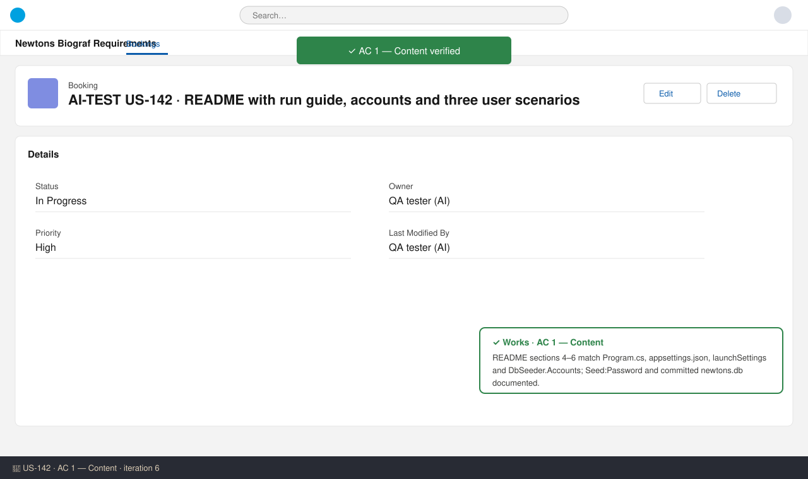
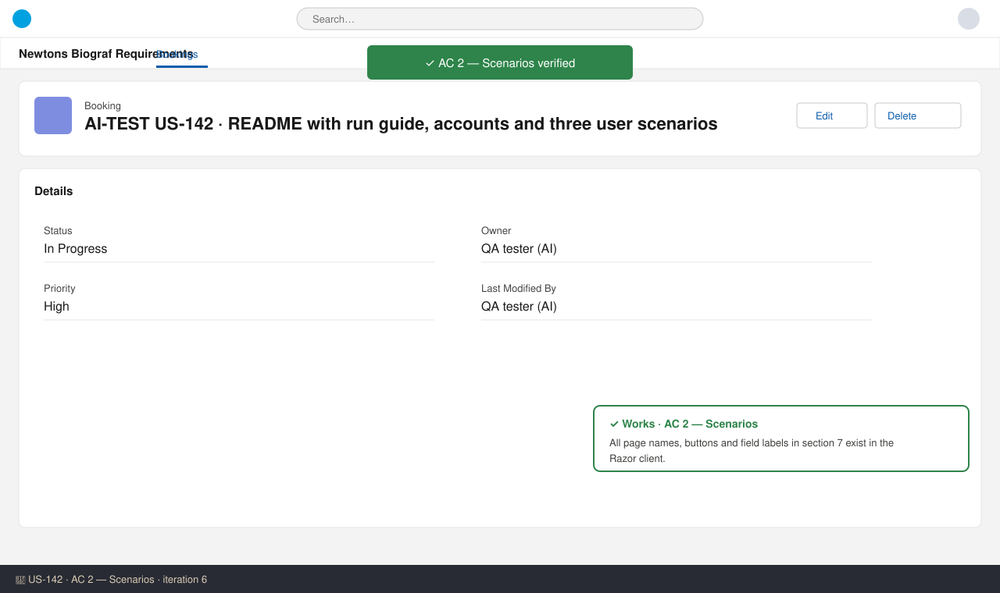
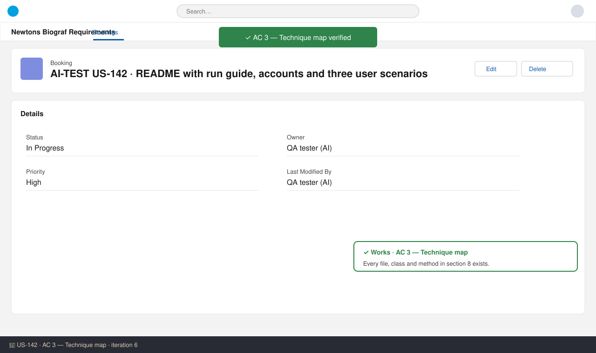
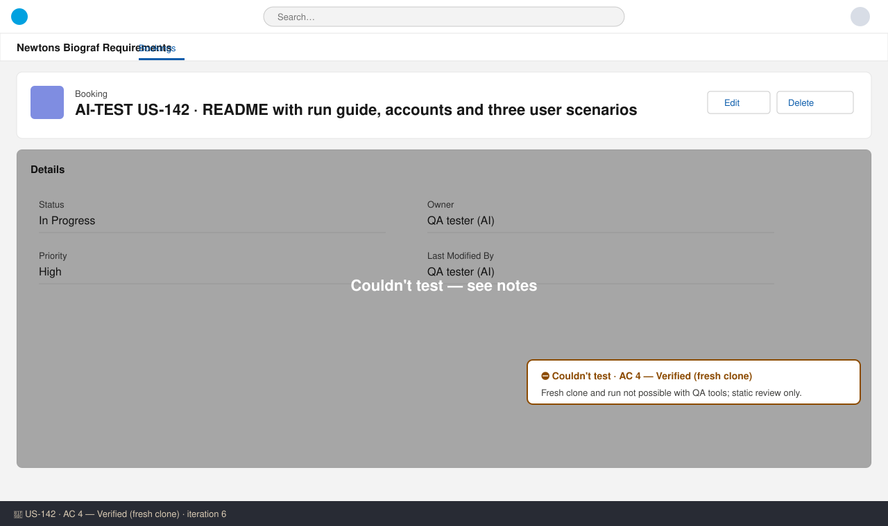

# US-142 — Test report (iteration 6)
**Verdict:** ✅ Approved (with notes) · **Tester:** Cuélebre 🐉 · **Date:** 2026-11-02

## Summary
| Check | Result | Evidence |
|---|---|---|
| Project checks (typecheck, test, build) | ✅ | `run_checks` all exit 0 |
| AC 1: Content (incl. PO feedback on US-140) | ✅ |  |
| AC 2: Scenarios | ✅ |  |
| AC 3: Technique map | ✅ |  |
| AC 4: Fresh clone | ⛔ |  |

## Checks
### AC 1: Content — ✅ Works
**Steps:** read README sections 1–6 and compared with `appsettings.json`, `Program.cs`, both `launchSettings.json`, `wwwroot/appsettings.json`, `DbSeeder.cs`, `.gitignore`.
**Found:** all config keys and defaults match, including `Seed:Password` = `Newtons-Demo-2026` and `Seed:Enabled` (Development-only `MigrateAsync` + seed). URLs match. Six accounts with roles/permissions match `DbSeeder.Accounts`. `newtons.db` is present and not ignored. No "depends on US-140" notes remain. The PO feedback (section 4 run steps, section 6 password, notes removed) is applied.

### AC 2: Scenarios — ✅ Works
**Steps:** checked each page, button and label in section 7 against `Login`, `Home`, `ShowingFilter`, `ShowingTable`, `Book`, `MyBookings`, `MainLayout`, `Showings`, `ShowingForm`, `Staff` Razor files and `ShowingService`.
**Found:** every label exists (Log in, Find a showing, Book, Choose your seats, Booking confirmed, View my bookings, Schedule showing, Create staff account, Save). The overlap message format matches the service.

### AC 3: Technique map — ✅ Works
**Found:** every file, class and method named exists. Minor note: `Repository.cs` itself has no `AnyAsync`; it is used in the controllers named in the same row.

### AC 4: Verified — ⛔ Not tested
QA has no shell to clone and run both apps, and the developer did not clone either. Static review supports it, but it is not runtime-verified.

## Not tested
- AC 4: a fresh `git clone` and running API and client with the README was not performed. Recommend a human smoke test in UAT: clone, run sections 3–4, log in as `customer1@newtons.local` / `Newtons-Demo-2026`, run the three scenarios.
